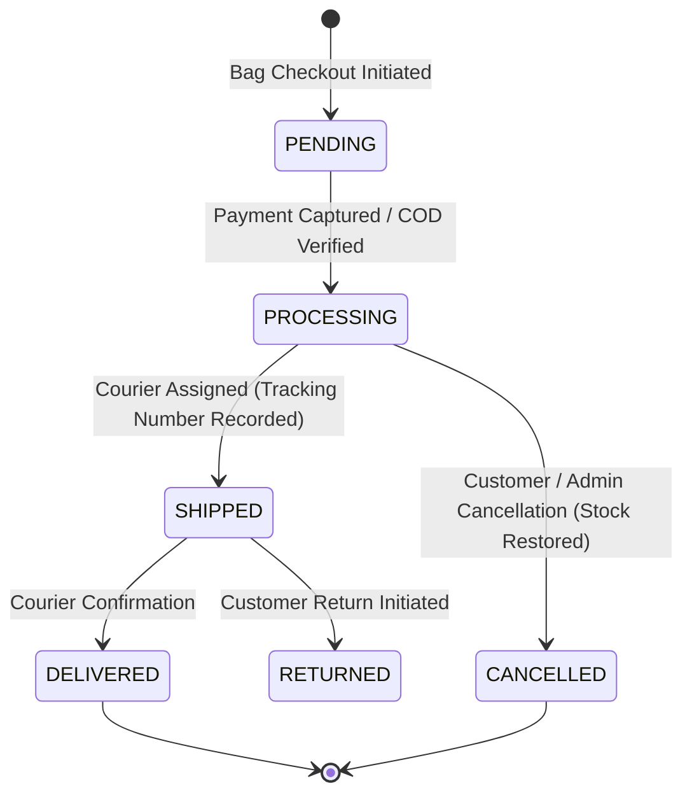

# Driptide E-Commerce Platform — System Architecture

## 1. Monorepo Organization
Driptide is structured as a high-performance monorepo using **pnpm workspaces** and **Turborepo**:

- **`apps/web`**: Next.js 16 (App Router, Turbopack, Tailwind CSS v4, Lucide Icons, React Hook Form, Context-based persistent bag).
- **`apps/api`**: NestJS Modular Monolith with Clean Architecture (REST `/api/v1`, class-validator, Supabase Auth JWT verification guard, Role Guard, Database Module).
- **`packages/contracts`**: Shared TypeScript interfaces, Enums (`UserRole`, `OrderStatus`, `PaymentStatus`, `FulfillmentStatus`, `InventoryMovementType`), and DTO contracts.
- **`supabase/`**: Normalized PostgreSQL migrations (`migrations/20261021000001_initial_schema.sql`), seed data (`seed.sql`), and Row Level Security (RLS) policies.

---

## 2. Core Architectural Invariants

### 2.1 Authoritative Pricing and Monetary Precision
- **Integer Minor Units**: All monetary amounts are recorded and processed strictly in integer minor units (cents, e.g. `$340.00` = `34000`).
- **Immutable Price Snapshots**: When an order is placed, unit price, SKU, product name, and variant title are permanently snapshotted into `order_items`. Historical totals are never computed from mutable current product prices.
- **Authoritative Server Calculations**: Client-supplied prices, totals, and discount amounts are strictly ignored. The backend recalculates all item totals, shipping tiers, taxes, and coupon discounts from authoritative database rows.

### 2.2 Concurrency & Atomic Stock Reservation
- The database schema introduces `reserve_and_deduct_inventory` and `release_inventory_on_cancellation`.
- When an order checkout occurs, variant rows in PostgreSQL are locked (`SELECT ... FOR UPDATE`), verifying that `stock_quantity >= requested_quantity`.
- Every stock change writes an immutable audit record to `inventory_movements` with before/after quantities and audit reasons.

### 2.3 Authentication and Least Privilege RBAC
- Identity is managed via Supabase Auth (or compatible mock bearer tokens during local development).
- Server-side routes are guarded via `SupabaseAuthGuard` and `RolesGuard`.
- Sensitive operations (product creation, inventory restock, order fulfillment) strictly require `UserRole.ADMIN`.
- Service-role keys are confined to trusted backend servers and never exposed to the frontend browser.

---

## 3. Order & Fulfillment State Machine

